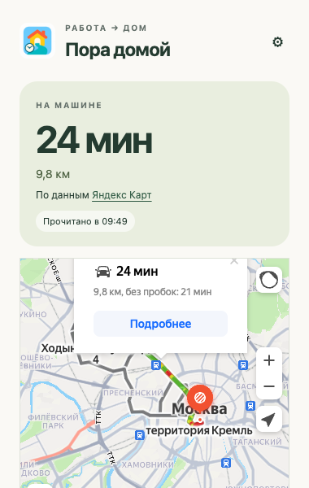

# Пора домой

**Дела — на экране. Дорога домой — на значке.**

Работаешь в браузере и собираешься домой на машине? «Пора домой» показывает, сколько ехать с учётом пробок по данным Яндекс Карт. Минуты видны на значке рядом с адресной строкой: можно оценить дорогу, продолжая читать почту, писать документы или заканчивать дела.

## Скачать

### [↓ Скачать актуальную версию для установки](https://github.com/bzSega/pora-domoy/raw/refs/heads/main/distr/pora-domoy-latest.zip)

**Версия 1.3.1 beta.** Готовый установочный архив лежит в папке [distr](distr/). Для установки не нужны Node.js, Python, npm или сборка.

## Установка — без программирования

1. Нажми **«Скачать актуальную версию для установки»** выше.
2. Распакуй ZIP и перемести полученную папку в постоянное место на компьютере. Не оставляй её внутри архива.
3. Открой `browser://extensions` в Яндекс Браузере и включи **режим разработчика**.
4. Нажми **«Загрузить распакованное расширение»** и выбери папку **`extension`** внутри распакованного архива. В ней находится файл `manifest.json`.
5. Закрепи значок «Пора домой» на панели браузера.

Папка `extension` должна оставаться на компьютере: браузер загружает расширение из неё.

## Настрой маршрут один раз

Открой расширение → «Построить маршрут по адресам», укажи работу и дом и открой Яндекс Карты. Проверь точки и автомобильный режим. На вкладке Карт нажми значок расширения → **«Взять из текущей вкладки»** → **«Сохранить и получить время»**.

Можно вставить полную ссылку маршрута из адресной строки Карт. Поддерживаются две точки и поездка на машине с отправлением сейчас. Короткие ссылки и промежуточные остановки не поддерживаются.

## Как пользоваться

Включи «Обновлять каждые 5 минут» и при желании выбери дни и часы. Дальше достаточно взглянуть на значок, чтобы понять, сколько сейчас займёт дорога, и решить, когда собираться домой. Постоянная вкладка Карт не нужна. Обновления работают, пока браузер запущен и компьютер не спит.

Например, **25** на значке — последняя свежая оценка поездки в минутах с учётом дорожной ситуации. **25?** — предыдущая оценка, которую нужно обновить: данные устарели, идёт запрос или произошла ошибка. Открой панель, чтобы увидеть расстояние, время чтения и интерактивную карту. Кнопка «Поехать на работу» меняет направление.

*Реальный интерфейс beta на публичном тестовом маршруте. Значение на скриншоте — пример расчёта.*

## Обновление без потери настроек

Скачай актуальный ZIP, распакуй его и замени файлы **в прежней папке `extension`**. Затем нажми круговую стрелку перезагрузки на карточке расширения в `browser://extensions`.

**Не удаляй расширение перед обновлением:** удаление стирает маршрут и настройки. Сохранение папки и перезагрузка позволяют их оставить.

## Если время не обновляется

Проверь интернет и нажми «Обновить время». При необходимости открой маршрут в Картах. Если сайт требует проверку, пройди её самостоятельно. В разделе «Если время не обновляется» доступен запасной режим чтения из открытой вкладки.

Через десять минут оценка отмечается устаревшей; после суток она удаляется при следующем обращении к расширению. Время чтения карточки не означает время измерения пробок. Виджет может выбрать другой путь, чем открытая ранее карта; вручную выбранная альтернатива не сохраняется.

## Данные, условия и поддержка

Маршрут и настройки хранятся в твоём браузере. Координаты передаются Яндексу для карты и расчёта, адреса — при построении маршрута. Разработчик их автоматически не получает. В этой версии нет рекламы, аналитики разработчика или подписки.

Бесплатный независимый проект для личного планирования поездок. Предоставляется «как есть», без гарантий точности и доступности; не является официальным продуктом Яндекса. Код — [MIT](LICENSE). Карты и данные Яндекса регулируются отдельно. [Условия использования](TERMS.md) · [Конфиденциальность](extension/privacy.html).

Поддержка: [sergey@mikhaylov.com](mailto:sergey@mikhaylov.com). Не присылай адрес дома или полную ссылку своего маршрута. Для сообщения об ошибке можно скопировать «Диагностику без адресов» из панели.

---

Разработчикам: инструкции по тестированию и сборке — в [CONTRIBUTING.md](CONTRIBUTING.md). Для обычной установки они не нужны.
